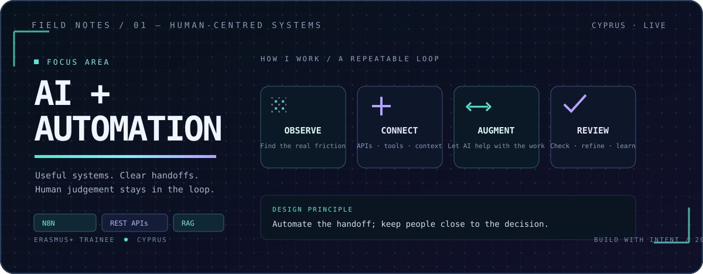

  
   
  
   
  
  
  

### ◈ How I think about systems

| **01 · OBSERVE** | **02 · CONNECT** | **03 · AUGMENT** | **04 · REVIEW** |
|:---:|:---:|:---:|:---:|
| Find the real friction | Bring tools and context together | Use AI where it helps | Keep outputs clear and checked |

> **Working principle** · Automate the handoff; keep people close to the decision.

### ◈ Automation toolkit

| **WORKFLOW & INTEGRATION** | **APPLIED AI** | **BUILD & DATA** |
|:---|:---|:---|
|     |   |     |

### ◈ Across Europe · learning by doing

| 🇨🇾 **CYPRUS · NOW** | 🇨🇿 **PRAGUE** | 🇸🇮 **SLOVENIA** | 🇮🇹 **MESSINA** |
|:---:|:---:|:---:|:---:|
| Erasmus+ Traineeship Herbs Are My World | Erasmus+ Traineeship GiftsServices | Erasmus exchange University of Primorska | BSc Computer Science Data Analysis |

### ◈ GitHub signal

  
  

  <picture>
    <source media="(prefers-color-scheme: dark)" srcset="https://raw.githubusercontent.com/Anas-git007/Anas-git007/output/github-contribution-grid-snake-dark.svg" />
    <source media="(prefers-color-scheme: light)" srcset="https://raw.githubusercontent.com/Anas-git007/Anas-git007/output/github-contribution-grid-snake.svg" />
    
  </picture>

